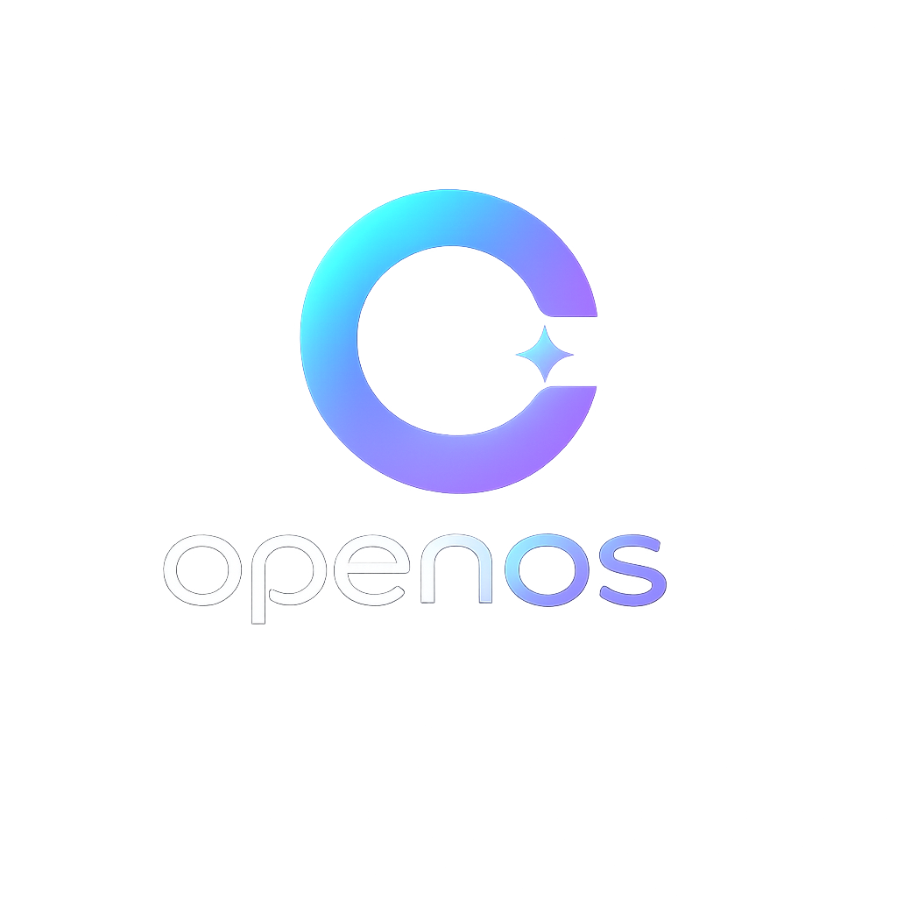

<div align="center">



# 🧠 OpenOS (@openos07)

### *The Sovereign AI-Native Operating System*
**Talk to your computer. It understands.**

<br/>

[](https://github.com/openos07/openos)
[](https://github.com/openos07/openos)
[](https://openos07.github.io/openos/)
[](https://github.com/openos07/openos/releases/tag/v0.3.0)
[](https://github.com/openos07/openos/blob/main/LICENSE)

</div>

> [!IMPORTANT]
> 🚀 **Official Contract Address (CA):** **Soon Available**  
> Stay tuned on our official channels. Official token and address verification will be announced exclusively on [github.com/openos07/openos](https://github.com/openos07/openos). Beware of fake contracts!

---

## 🌟 Welcome to OpenOS

[**OpenOS**](https://github.com/openos07/openos) replaces traditional menus, terminals, and app launchers with a unified sovereign AI interface. Built on Debian Bookworm and powered by local open-weight LLMs via Ollama, OpenOS translates your natural language into native operating system actions:

- **Traditional OS:** User ➔ App ➔ Action
- **OpenOS:** User ➔ AI ➔ Action

```bash
openos "open my project files"
openos "clean and optimize my system"
openos "prepare my work setup"
openos "play some lo-fi music"
```

---

## ✨ Flagship Capabilities

| Feature | Highlight |
|---|---|
| 🗣️ **Natural Language Control** | Interact effortlessly via AI Shell, Voice, or GTK4 Desktop Panel |
| ⚡ **Autonomous Task Engine** | Multi-step task decomposition and native Linux execution |
| 🔒 **100% Sovereign Local AI** | Zero telemetry, offline inference powered by Ollama |
| 📁 **Smart File & System Manager** | Automatic file organization, system maintenance, and deduplication |
| 🧠 **Persistent Memory** | Learns workflows and custom preferences locally |

---

## 🚀 Official Links & Resources

- 💻 **Core Repository:** [github.com/openos07/openos](https://github.com/openos07/openos)
- 🌐 **Project Website:** [openos07.github.io/openos](https://openos07.github.io/openos/)
- 📦 **Latest Release:** [OpenOS v0.3.0](https://github.com/openos07/openos/releases/tag/v0.3.0)
- 📖 **Architecture Docs:** [ARCHITECTURE.md](https://github.com/openos07/openos/blob/main/docs/ARCHITECTURE.md)
- 💿 **ISO Build Guide:** [isobuild.md](https://github.com/openos07/openos/blob/main/docs/isobuild.md)

---

## 🛠️ Technology Stack

- **Operating System Base:** Debian 12 (Bookworm) / Live Build
- **Core Runtime:** Python 3.11+, AsyncIO
- **Local AI Brain:** Ollama, Function Calling & Tool Routing
- **Desktop Environment:** GTK 4, Libadwaita
- **Automation & Shell:** Bash, Make, Custom Event Bus Daemon

---

## 📬 Connect & Community

- **Creator:** Yashab Alam
- **X / Twitter:** [@_gh0st0fs0l](https://x.com/_gh0st0fs0l)
- **Email inquiries:** `yashabalam9@gmail.com` • `yashabalam707@gmail.com`

<div align="center">

*Empowering humans with sovereign, accessible, and intelligent computing.*

</div>
